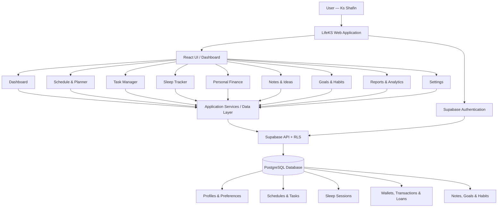
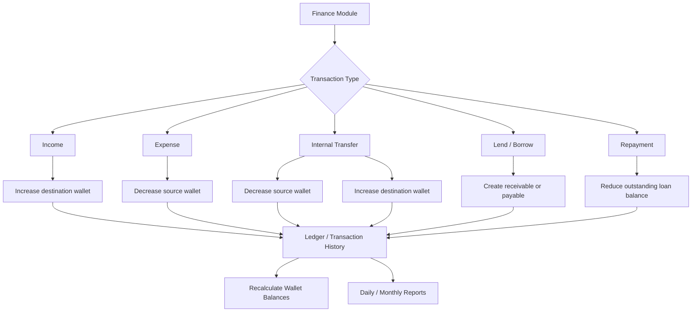
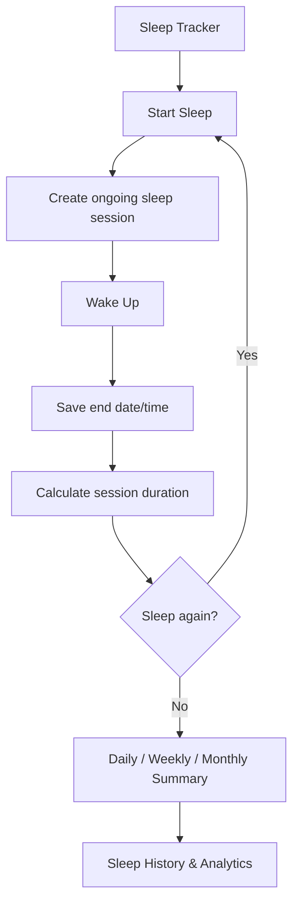

# LifeKS — Personal Life Management System

> **Tagline:** Manage Your Time. Track Your Money. Own Your Life.  
> **Project type:** Personal Productivity & Finance Management Web Application  
> **Owner:** Ks Shafin  
> **Status:** Project brief / development specification

---

## 1. Project Overview

**LifeKS** is a private, personal-use web application that brings everyday planning, task management, sleep tracking, and personal finance into one centralized dashboard.

The goal is to open one application and quickly understand:

- What do I need to do today?
- What is my next scheduled activity?
- Which tasks are pending, completed, or overdue?
- How long did I sleep, including multiple sleep sessions?
- How much money do I currently have across my wallets?
- Where did today's money come from?
- What did I spend, who did I pay, and which wallet did I use?
- Who owes me money, and whom do I owe?

LifeKS should be modular and expandable so more personal-life features can be added later without rebuilding the application.

## 2. Design Inspiration: MY DTI

**Reference website:** https://mydtibyksshafin.vercel.app/

Before development, visit and study the reference website. Use it as inspiration for:

- Dashboard structure and information hierarchy
- Sidebar navigation and page organization
- Reusable cards and widgets
- Responsive layout behavior
- Navigation and interaction patterns
- Typography, spacing, and general usability

**Important:** MY DTI is a design and UX reference only. Do not clone it or reuse its blue branding. LifeKS must have its own identity, components, layout refinements, and functionality.

## 3. Branding & UI Direction

### Brand

- **Name:** LifeKS
- **Tagline:** Manage Your Time. Track Your Money. Own Your Life.
- **Primary identity:** Red gradient
- **Visual style:** Premium, minimal, modern, clean, and practical

### Light mode

- White / warm-neutral surfaces
- Deep red and red gradient accents
- Soft red highlights
- High-contrast readable typography

### Dark mode

- Deep charcoal / near-black surfaces
- Red and soft-red accents
- Carefully balanced contrast
- Avoid large areas of bright red

### UI requirements

- Responsive sidebar and top navigation
- Clear page titles and useful page descriptions
- Reusable cards, tables, forms, dialogs, and filters
- Consistent spacing, typography, borders, and radii
- Subtle transitions and useful micro-interactions
- Accessible labels, keyboard-friendly controls, and visible focus states
- Responsive desktop, tablet, and mobile layouts
- No decorative clutter or generic template appearance

Theme selection must be available in Settings and persist across sessions. Local storage may be used for harmless UI preferences such as theme only.

## 4. Main Navigation / Modules

1. Dashboard
2. Schedule & Planner
3. Task Manager
4. Sleep Tracker
5. Personal Finance
6. Wallet Management
7. Transaction History
8. Notes & Ideas
9. Goals & Habits
10. Reports & Analytics
11. Settings

---

## 5. Functional Requirements

### 5.1 Dashboard

Create a central overview with:

- Current date and time
- Greeting
- Today's schedules
- Next upcoming activity and time remaining
- Currently active activity
- Pending, completed, and overdue tasks
- Daily productivity progress
- Sleep summary / latest sleep session
- Total available balance
- Individual wallet balances
- Today's income and expenses
- Recent transactions

Dashboard values must come from actual saved records, not hardcoded demo values. If demo data is included for preview, clearly label it as sample data and provide a way to distinguish or remove it.

### 5.2 Schedule & Planner

Allow users to create, view, edit, and delete schedule entries.

Fields:

- Title
- Description
- Date
- Start date/time
- End date/time
- Category
- Priority
- Reminder settings
- Recurrence rule (optional)

Views:

- Daily
- Weekly
- Monthly

Show:

- Upcoming activities
- Currently active activity
- Completed activities
- Missed / past-due activities
- Time remaining until the next activity

Allow manual completion status. Handle date and time boundaries correctly. Warn about overlapping schedules where appropriate, but do not silently discard valid entries.

### 5.3 Task Manager

Task fields:

- Title
- Description
- Deadline
- Priority (High / Medium / Low)
- Category
- Status (Pending / In Progress / Completed / Cancelled)
- Optional linked schedule

Features:

- Create, edit, delete, and complete tasks
- Search and filter by date, priority, category, and status
- Separate overdue tasks
- Show task completion progress

### 5.4 Sleep Tracker

Sleep tracking must support **multiple sleep sessions in one calendar day**.

Example:
- Fell asleep at 1:30 AM
- Woke up at 7:00 AM
- Went back to sleep at 9:00 AM
- Woke up at 11:30 AM

Store each sleep session separately. Calculate:

- Duration of each session
- Total sleep duration for a selected day
- Number of sessions
- Time awake between sessions (where it can be calculated reliably)
- Daily, weekly, and monthly sleep summaries
- Average sleep duration
- Sleep history and trends

Actions:

- Start Sleep Session
- Wake Up / End Sleep Session
- Manually add a past sleep session
- Edit a session
- Delete a session

Each session should store:

- Start date/time
- End date/time (nullable while ongoing)
- Optional notes

Rules:

- Sessions may cross midnight.
- An ongoing session must be shown as ongoing.
- Do not treat an incomplete session as a completed duration.
- Prevent impossible or invalid time ranges.
- Prevent multiple simultaneously active sessions for the same user unless a deliberate product decision supports them.
- Use the user's configured timezone consistently.
- Clearly define how a sleep day is assigned when a session crosses midnight. Prefer grouping by the session's start date while also allowing calendar-day overlap reporting if implemented.

### 5.5 Personal Finance

Use **BDT (৳)** as the default currency.

#### Wallets

Default wallet examples:

- Cash
- bKash
- Nagad
- Bank Account

Users can add, edit, archive, and manage custom wallets.

Wallet fields:

- Name
- Type
- Opening balance
- Current calculated balance
- Currency
- Created date
- Active / archived status

#### Income

Record:

- Amount
- Received from (person / organization)
- Source / category
- Destination wallet
- Date and time
- Description / notes

Example sources: family, friends, salary, freelance work, refunds, other income.

#### Expenses

Record:

- Amount
- Paid to (person / merchant)
- Expense category
- Source wallet
- Date and time
- Description / notes

Example categories: food, transport, shopping, education, internet, personal, entertainment, bills, other.

#### Internal wallet transfers

Example: transfer ৳1,000 from Cash to bKash.

Rules:

- Subtract from source wallet.
- Add to destination wallet.
- Do not count as income.
- Do not count as expense.
- Total assets across wallets remain unchanged.
- Store a single transfer record or a properly linked pair of ledger entries so the transfer cannot be counted twice.

#### Lending and borrowing

Track:

- Money lent to another person (receivable)
- Money borrowed from another person (payable)
- Person's name
- Amount
- Date
- Reason
- Wallet involved
- Expected repayment date (optional)
- Repayment status
- Partial repayments

Keep outstanding receivables and payables distinct from income and expenses. Define consistent accounting behavior for lending, borrowing, and repayments so wallet balances and reports remain accurate.

#### Daily money activity

For any selected date, show a timeline or grouped list of:

- Who gave money
- How much was received
- Income source
- Where money was spent
- Who was paid
- Amount spent
- Wallet used
- Internal transfers
- Loan given / borrowed / repayments

Allow navigating to previous dates and filtering by wallet, transaction type, person, and category.

### 5.6 Transaction History

Searchable and filterable transaction list with:

- Date/time
- Type
- Person / source / destination
- Description
- Wallet
- Category
- Amount

Support date range, wallet, type, person, and category filters. Editing or deleting a transaction must correctly update all derived balances and reports.

### 5.7 Notes & Ideas

- Create, edit, and delete notes
- Pin important notes
- Categories / tags
- Search
- Created and updated timestamps

### 5.8 Goals & Habits

- Daily habits
- Weekly and monthly goals
- Completion tracking
- Progress percentage
- Habit streaks
- History of completions

### 5.9 Reports & Analytics

Use clear charts and summaries.

Finance reports:

- Income vs expense by day / week / month
- Category-wise expenses
- Wallet-wise balances
- Balance history
- Lending and borrowing summary
- Savings / net cash flow

Sleep reports:

- Daily sleep duration
- Weekly and monthly averages
- Sleep session history
- Session count

Productivity reports:

- Tasks completed / pending / overdue
- Weekly productivity
- Goal progress
- Schedule completion

All reports must be calculated from saved data and support relevant date filters.

### 5.10 Settings

- Light / Dark theme
- Currency (default BDT)
- Timezone
- Wallet management
- Category management
- Profile / account settings
- Data export
- Backup and restore
- Secure sign out
- Clear data with strong confirmation

---

## 6. Data Storage, Security & Reliability

### Core requirement

**Do not rely on browser LocalStorage as the primary storage for important personal records.**

Recommended stack:

- React + Vite
- Supabase Authentication
- Supabase PostgreSQL database
- Supabase Row Level Security (RLS)
- Supabase client SDK
- Environment variables for configuration

Cloud database is the source of truth. Local storage may be used only for non-sensitive preferences or temporary UI state.

### Data safety requirements

- Every private record must be associated with the authenticated owner.
- Enable and test RLS policies on every user-owned table.
- Never expose Supabase service-role keys in frontend code.
- Use only the public/anon key in the browser with correct RLS policies.
- Validate data before writes.
- Handle loading, offline, timeout, and failed-save states.
- Do not show “saved” until the database confirms success.
- Avoid duplicate submissions.
- Use database constraints and transactions where appropriate.
- Provide export and backup guidance.
- Explain that cloud storage is not a substitute for independent backups.
- Never claim that backup, sync, or database connection is working until it has been configured and tested.

### Suggested database tables

- `profiles`
- `wallets`
- `people`
- `transactions`
- `loans`
- `loan_repayments`
- `schedules`
- `tasks`
- `sleep_sessions`
- `notes`
- `goals`
- `habits`
- `habit_completions`
- `user_preferences`

Use UUID primary keys, timestamps, foreign keys, indexes, appropriate numeric types for money, and user ownership fields. Use database migrations checked into the project repository.

For money, avoid floating-point arithmetic. Use an appropriate fixed-precision decimal or integer minor-unit representation and document the choice.

For transactions, keep an auditable ledger or reliable transaction model. Do not store a manually editable wallet balance as the only source of truth. Wallet balances should be derived consistently from opening balance and valid ledger movements, or maintained through safe database transactions with reconciliation support.

---

## 7. Architecture Diagram



## 8. Finance Logic Diagram



## 9. Sleep Tracking Logic Diagram



## 10. Suggested Technology Stack

| Layer | Technology |
|---|---|
| Frontend | React + Vite |
| Language | JavaScript (unless TypeScript is justified) |
| Styling | Tailwind CSS |
| Routing | React Router |
| Icons | Lucide React |
| Charts | Recharts |
| Backend / BaaS | Supabase |
| Database | PostgreSQL |
| Authentication | Supabase Auth |
| Access control | Supabase RLS |
| Hosting | Vercel |
| Version control | Git + GitHub |

Keep dependencies current and compatible. Do not invent package versions; verify the installed environment and official documentation when implementing.

## 11. Suggested Project Structure

```text
lifeks/
├── public/
├── src/
│   ├── app/
│   ├── assets/
│   ├── components/
│   │   ├── ui/
│   │   ├── layout/
│   │   └── shared/
│   ├── features/
│   │   ├── dashboard/
│   │   ├── schedule/
│   │   ├── tasks/
│   │   ├── sleep/
│   │   ├── finance/
│   │   ├── wallets/
│   │   ├── transactions/
│   │   ├── notes/
│   │   ├── goals/
│   │   ├── reports/
│   │   └── settings/
│   ├── hooks/
│   ├── lib/
│   │   └── supabase/
│   ├── services/
│   ├── utils/
│   └── styles/
├── supabase/
│   ├── migrations/
│   └── seed.sql
├── .env.example
├── README.md
└── package.json
```

The exact structure may be improved if there is a clear architectural reason. Keep modules organized and avoid a giant component.

## 12. Development Phases

Build incrementally. Do not attempt to implement every module in one rushed step.

### Phase 1 — Foundation & UI

- Study MY DTI reference
- Set up React + Vite
- Configure Tailwind
- Create LifeKS design system
- Build sidebar, topbar, routing, responsive layout
- Implement light / dark theme
- Create dashboard shell and empty states

### Phase 2 — Cloud Foundation

- Create Supabase integration
- Configure environment variables
- Create database migrations
- Configure authentication
- Add RLS policies
- Verify private data access

### Phase 3 — Schedule & Tasks

- Schedule CRUD
- Calendar views
- Task CRUD
- Priority and status
- Dashboard integration

### Phase 4 — Sleep Tracker

- Start / end sleep
- Manual session entry
- Multiple sessions per day
- Cross-midnight handling
- Duration calculations
- Sleep analytics

### Phase 5 — Finance

- Wallets
- Income
- Expenses
- Transfers
- Lending and borrowing
- Partial repayments
- Daily money timeline
- Transaction history
- Balance reconciliation

### Phase 6 — Workspace & Analytics

- Notes
- Goals and habits
- Reports and charts
- Date filters
- Data export

### Phase 7 — QA & Release

- Test all CRUD operations
- Test sleep edge cases
- Test finance calculations
- Test RLS and user isolation
- Test mobile responsiveness
- Test refresh / sign-in persistence
- Add setup and deployment documentation
- Prepare for Vercel deployment

---

## 13. Acceptance Criteria

The application is not complete just because the screens look good.

### General

- Every navigation link works.
- Forms validate input.
- Create, read, update, and delete operations work.
- Loading, empty, success, and error states exist.
- Data remains after refresh and after signing in again.
- Light and dark themes work on all pages.
- Layout works on mobile and desktop.

### Sleep

- Multiple sessions can be recorded on one day.
- Cross-midnight sessions calculate correctly.
- Ongoing sessions are not counted as completed.
- Editing a session updates summaries.
- Invalid or overlapping sessions are handled safely.

### Finance

- Income increases the correct wallet.
- Expense decreases the correct wallet.
- Internal transfer changes two wallets but not total funds.
- Loans and repayments update outstanding balances correctly.
- Editing or deleting a transaction updates derived values.
- Reports do not double-count transfers or loan principal.
- Monetary calculations avoid floating-point errors.

### Security & Persistence

- Unauthenticated users cannot access private records.
- RLS is enabled and verified.
- Secret keys are not exposed.
- Database save failures are visible.
- Export / backup instructions are documented.

---

## 14. Instructions to Claude Code

Read this entire README before writing code.

1. First inspect the existing workspace and available tools.
2. Visit and study https://mydtibyksshafin.vercel.app/ as a UX reference.
3. Summarize the planned architecture and database model.
4. Identify any missing setup credentials. Never fabricate credentials.
5. Build the project in the phases above.
6. Do not leave fake buttons or non-functional controls.
7. Do not silently replace cloud storage with LocalStorage.
8. Use clearly labelled demo data only where useful.
9. Run the available build, lint, and tests.
10. Fix errors before packaging.
11. Create a complete project ZIP containing source code, migrations, `.env.example`, and documentation.
12. Do not include `node_modules`, real `.env` secrets, API keys, passwords, or personal financial data in the ZIP.
13. Include clear setup instructions for installing dependencies, configuring Supabase, running locally, and deploying to Vercel.
14. Report what is implemented, what requires my Supabase credentials, and any known limitations.

**Deliverable:** A working, well-organized LifeKS project folder and a ZIP archive ready for me to review and push to GitHub.

## 15. Scope Control

Build only the features defined in this specification for the first release. Keep the architecture extensible for future modules, but do not invent extra features that distract from the current scope.

**Product identity:** LifeKS  
**Tagline:** Manage Your Time. Track Your Money. Own Your Life.
